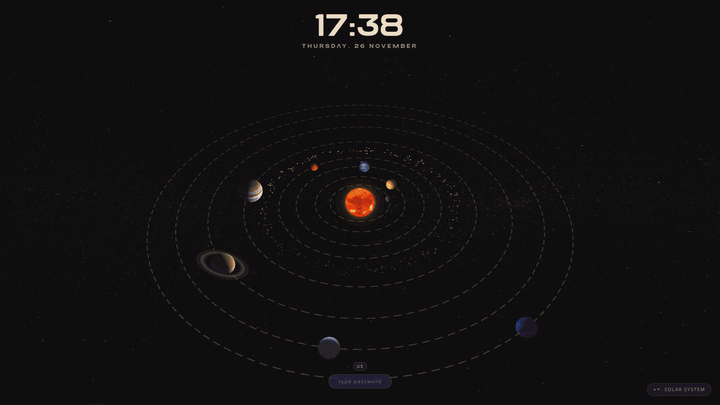
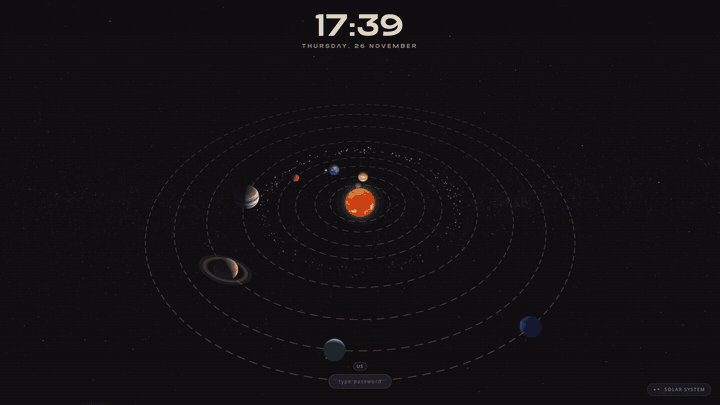

# Solar Lock

An animated, interactive 3D solar system as your lockscreen. Textured planets orbit a glowing Sun behind a
clock; hover a planet to learn about it, click to fly in on it, and type your password to unlock.



- **Real-looking worlds:** photo textures for every planet, Earth's clouds and Moon, Saturn's rings, an asteroid belt and sharp dashed orbits
- **Interactive:** hover a planet, the Moon or the Sun for a description card, click to zoom in, scroll to zoom
- **Two themes:** the real Solar System, or a second, made-up *Hearthian System* with its own planets and effects (see [Themes](#themes))
- **Supernova:** every 22 minutes of being locked the textured Sun slowly shrinks into a small white sphere, turns blue and swells in a growing glow, then the whole screen blows out white and fades to black before everything fades back in
- **Polished:** fade in on lock, fade out on unlock, clock and date, a password pill with dots
- **Safe fallback:** if the lock fails to start or crashes, `hyprlock` takes over (Hyprland)

| Desktop | How it works | Setup |
| --- | --- | --- |
| **Hyprland**, Sway and other compositors with `ext-session-lock-v1` | [Quickshell](https://quickshell.org) draws the lock and checks the password through PAM | [Hyprland setup](#hyprland-and-other-wayland-compositors) |
| **KDE Plasma** | The same scene runs inside KDE's own screen locker | [KDE Plasma setup](#kde-plasma) |

## Quick start

**1. Install the dependencies** (Arch package names):

```sh
sudo pacman -S quickshell qt6-quick3d assimp hyprlock python-pillow python-numpy
```

| Package | Used for |
| --- | --- |
| `quickshell` | Runs the lock on Hyprland and similar compositors (not needed on KDE) |
| `qt6-quick3d` | The 3D scene |
| `hyprlock` | Provides the PAM service for the password check, and the crash fallback (not needed on KDE) |
| `assimp` | Lets Qt load the Hearthian theme's planet meshes (`.glb`) |
| `python-pillow` | The texture script below |
| `python-numpy` | The mesh script below (Hearthian theme) |

Optional: the *Scenesa* font for the clock. Qt uses a default font if it is missing.

Quickshell must be built against the Qt version you have installed. If it warns *"built against Qt X but the
system has updated to Qt Y"*, update or rebuild the `quickshell` package, because a mismatch can crash the lock.

**2. Get the code and download the textures:**

```sh
git clone https://github.com/1ceblink/quickshell-solar-lock.git ~/.local/share/quickshell-solar-lock
cd ~/.local/share/quickshell-solar-lock
python3 tools/fetch_textures.py
python3 tools/make_hearthian_meshes.py
```

> **The texture step is required.** The planet textures are not stored in this repository (they are CC BY 4.0,
> so they are downloaded instead). Without them the planets render as untextured blobs, and `bin/lock-solar`
> refuses to start the scene and uses `hyprlock` instead. The script needs an internet connection and about
> 7 MB of disk.

**3. Preview it in a window** (Hyprland route; on KDE use the test command in the [KDE section](#kde-plasma)). Nothing is locked, and typing only prints to the terminal:

```sh
qs -p ~/.local/share/quickshell-solar-lock/dev.qml
```

Then continue with the setup for your desktop.

## Hyprland and other Wayland compositors

`bin/lock-solar` starts the lock and falls back to `hyprlock` if it fails. Point your lock key at it, and let
Hyprland restore the lock after a crash.

`hyprland.conf`:

```ini
misc {
    allow_session_lock_restore = true
}
bind = SUPER, L, exec, ~/.local/share/quickshell-solar-lock/bin/lock-solar
```

`hyprland.lua`:

```lua
-- inside hl.config({ ... })
misc = { allow_session_lock_restore = true },

hl.bind("SUPER + L", hl.dsp.exec_cmd(os.getenv("HOME") .. "/.local/share/quickshell-solar-lock/bin/lock-solar"))
```

The same script works as the lock command of an idle daemon (for example `lock_cmd` in `hypridle.conf`).
On other compositors that support `ext-session-lock-v1`, bind your lock key to the same script.

## KDE Plasma

KWin does not implement `ext-session-lock-v1`, so `bin/lock-solar` cannot lock a Plasma session. Instead the
same `Scene.qml` runs inside KDE's screen locker (`kscreenlocker_greet`), which keeps doing the real locking,
the password check, multi-monitor handling and crash recovery. Quickshell and `hyprlock` are not needed.

```sh
python3 tools/fetch_textures.py      # if you have not done it yet
bin/install-kde
```

Test it in a window without locking, then lock with `Meta+L` (keep a TTY logged in the first time):

```sh
/usr/lib/kscreenlocker_greet --testing
```

To undo it, run `bin/uninstall-kde` and log out and back in.

**What `install-kde` does.** The locker loads its UI from `lockscreen/LockScreen.qml` in the Plasma shell
package `org.kde.plasma.desktop`. Plasma only serves files inside a package, and a user package with that name
hides the system one completely, so the script:

- copies `/usr/share/plasma/shells/org.kde.plasma.desktop` to `~/.local/share/plasma/shells/` and replaces only
  `contents/lockscreen/` with `kde/lockscreen/LockScreen.qml` plus symlinks to `Scene.qml`, the theme files and `textures/`.
  Everything else is identical, so the desktop, panels and widgets are unaffected;
- installs `~/.config/plasma-workspace/env/solar-lock-kde.sh`, which rebuilds that copy from the current system
  package at every login, so a Plasma update never leaves a stale copy behind.

Because `Scene.qml`, the theme files and `textures/` are symlinks, updating this repository updates the KDE lock too. Only a
change to `kde/lockscreen/LockScreen.qml` needs `bin/install-kde` again (or a re-login).

Compared with the stock Plasma lockscreen you lose the Sleep / Switch User buttons, media controls, the
keyboard-layout switcher and the authenticator picker. If the QML ever fails to load, KDE shows its built-in
fallback lockscreen and the session stays locked.

## Using it

| Action | Result |
| --- | --- |
| Hover a planet, the Moon or the Sun | The body glows softly in its own colour and a card shows its name, orbit and a short description |
| Click a planet, the Moon or the Sun | The camera glides in on it, and its description card appears once the zoom has finished; click it again, or empty space, to zoom back out |
| Scroll | Zoom in or out |
| Up / Down (password empty) or the button in the bottom-right corner | Switch theme (see [Themes](#themes)) |
| Type | Dots appear in the pill (the password itself is never shown) |
| Caps Lock, layout | A small chip above the pill shows the active keyboard layout (`US`, `RU`, …) and an amber `CAPS LOCK` chip appears while it is on (Hyprland only: it reads them from `hyprctl`) |
| Backspace / Ctrl+Backspace | Delete one character / clear everything |
| Esc | Zoom back out when zoomed in on a planet, otherwise clear the password |
| Enter | Submit. A wrong password shows "wrong password" in red; typing again clears it |

## The supernova



Every **22 minutes of being locked** the Sun goes supernova.

The timer counts time spent locked and starts over every time you lock, so a short lock never sees it. Unlocking while it plays cancels it. Change the interval with `novaInterval` in `Scene.qml` (milliseconds, default `22 * 60 * 1000`).

## Themes

| Theme | What you see |
| --- | --- |
| **Solar System** (`solar`) | The real planets with photo textures, Earth's Moon and the asteroid belt |
| **Hearthian System** (`hearthian`) | The Sun Station, the Hourglass Twins pouring sand between them, Timber Hearth and the Attlerock, Brittle Hollow with its black hole and Hollow's Lantern, Giant's Deep with its cyclones and the Orbital Probe Cannon, Dark Bramble, the Interloper on its stretched orbit, and the Quantum Moon |

Press **Up** or **Down** while the password field is empty, or click the button in the bottom-right corner, to
switch. Once you have typed a character the arrows do nothing, so they can never get in the way of a password.
A switch lasts until you unlock; the theme shown when the lock starts is `theme` in `Scene.qml`.

The **Quantum Moon** only moves while nobody is looking. When it is off
screen (you zoomed in somewhere else), hidden behind a nearer body, or the screen is dark (the fade-in, a theme
switch, after the supernova), it jumps to an orbit around another world. While you hover or select it, it stays put.

**Planet models.** The Hearthian planets are original meshes generated by `tools/make_hearthian_meshes.py` into
`models/generated/` (noise, craters, dunes, vines; about 8 MB, one second). The effects (the sand column, the
cyclones, Dark Bramble's fog, the black hole, the comet's tail) are drawn by the theme itself. If the meshes are
missing, simple shapes stand in.

Your own models can go into `models/ow/` (one `.glb` per body, centred, Y up, radius 1, named like the generated
ones, e.g. `timber_hearth.glb`); those are used instead. `sun_station.glb` and `orbital_probe_cannon.glb` replace
those two bodies' simple shapes.

## Customising

Almost everything is in `Scene.qml` and the theme files (`SolarSystem.qml`, `HearthianSystem.qml`):

| What | Where |
| --- | --- |
| The theme shown when the lock starts (`"solar"` or `"hearthian"`) | `theme` in `Scene.qml` |
| Planet names, orbit radius, size, tilt, spin speed and description text | the `planets` list at the top of each theme file |
| How far the camera sits (increase it to shrink the whole system) | `homeZ` |
| Fade durations | `fadeIn` and `fadeOut` |
| How often the supernova happens (milliseconds, default `22 * 60 * 1000`; it counts time spent locked and starts over each time you lock) | `novaInterval` |
| The supernova's timing, size and colours | the `// ---- supernova` block and the `novaAnim` sequence |
| Clock font, size and position | the `// clock` block |
| Lighting and anti-aliasing | the `PointLight` and `SceneEnvironment` in the 3D view |

Two settings live in `shell.qml`: `config: "hyprlock"` is the PAM service name (use `"login"` if you do not
have `hyprlock`), and `settings.watchFiles: false` must stay off (see below).

**Several monitors:** set `SOLAR_LOCK_SCREEN` to part of one screen's output name or model (as `hyprctl monitors`
shows it, e.g. `SOLAR_LOCK_SCREEN=HDMI-A-1` or `SOLAR_LOCK_SCREEN=G24-20` in front of `lock-solar`) to show the scene
only there. The other screens stay black, and typing on them still goes to the password. If no screen matches,
every screen shows the scene.

While you experiment, use `dev.qml` rather than the real lock.

## Safety and recovery

- **Keep a TTY open the first time.** Press `Ctrl+Alt+F3`, log in, then return with your session's TTY key
  (usually `Ctrl+Alt+F1` or `F2`). From the TTY, `pkill qs` stops a stuck lock. **Log out of that TTY when you are
  done testing:** a TTY left logged in lets anyone at the keyboard get around any screen lock.
- **If the lock crashes**, Hyprland keeps the session locked and shows a red screen. With
  `allow_session_lock_restore` on, `lock-solar` starts `hyprlock` so you can unlock normally.
- **Memory:** the lock uses roughly 240 MB while it is running (most of it texture memory) and exits completely
  after you unlock.

### Troubleshooting

| Problem | Fix |
| --- | --- |
| The lock key does nothing | A stuck lock process is blocking it. Run `pkill qs` and try again. Quickshell hot-reloads when files in its folder change and a reload destroys a running lock, which is why `shell.qml` turns file watching off |
| Planets look flat and untextured, or you get `hyprlock` instead | Run `python3 tools/fetch_textures.py` |
| Warning about a Qt version mismatch | Update or rebuild the `quickshell` package |
| The password is always rejected | Check the PAM service name in `shell.qml` (see Customising) |
| The clock uses a plain font | Install the Scenesa font, or set another `font.family` in the clock block |

## Security notes

- **The compositor does the locking.** On Hyprland and other `ext-session-lock-v1` compositors the compositor itself
  hides every other window and sends keyboard and mouse input only to the lock while it is active (on KDE Plasma its
  own screen locker does this). If the lock program crashes, the session stays locked.
- **The password is checked by PAM**, with the same service as `hyprlock` and your login. The scene never writes it to
  a log and drops it as soon as PAM has answered.
- **Failures never leave the screen unlocked.** If the lock fails to start, fails to load or crashes, `lock-solar`
  uses `hyprlock` instead, and a leftover lock process cannot turn the lock key into a silent no-op.
- **Downloads are verified.** `tools/fetch_textures.py` checks every texture against a known SHA-256 sum and refuses
  anything that does not match.
- **What no screen lock can do:** it protects a running session from someone at the keyboard. It does not protect
  against other TTYs left logged in, physical attacks on the machine, or code already running as your user. On KDE,
  `bin/install-kde` runs a small script from this repository's folder at every login, so keep that folder
  writable only by you.

## Repository layout

```text
LICENSE                         MIT
shell.qml                       the real lock (Hyprland and other compositors)
Scene.qml                       the Sun, supernova, clock, password pill and all interaction (shared by every desktop)
SolarSystem.qml                 the Solar System theme: planets, Moon, asteroid belt
HearthianSystem.qml             the Hearthian System theme, including the Quantum Moon
shaders/earth_night.frag        Earth's city lights, shown only on the night side
dev.qml                         windowed preview, no locking
bin/lock-solar                  launcher with the hyprlock fallback
bin/preview                     opens the scene in a window, nothing is locked
bin/install-kde, uninstall-kde  KDE Plasma setup and removal
kde/lockscreen/LockScreen.qml   the KDE greeter UI that hosts Scene.qml
tools/fetch_textures.py         downloads the textures and builds the ring and bump maps
packaging/arch/PKGBUILD         Arch Linux package (also the base for the AUR package)
tools/make_hearthian_meshes.py  generates the Hearthian planet meshes
textures/                       created by the script, not committed
models/                         generated meshes (and your own extracted ones), not committed
```

## Credits and licence

- Planet, Sun, Moon and ring textures: [Solar System Scope](https://www.solarsystemscope.com/textures/),
  licensed [CC BY 4.0](https://creativecommons.org/licenses/by/4.0/). They are downloaded by
  `tools/fetch_textures.py` and are not redistributed here. Please credit them if you share screenshots or videos.
- Built with [Quickshell](https://quickshell.org) and [Qt](https://www.qt.io).
- Licence: [MIT](LICENSE), except `kde/lockscreen/LockScreen.qml`, which keeps its `GPL-2.0-or-later` header because it follows KDE's own lockscreen.
